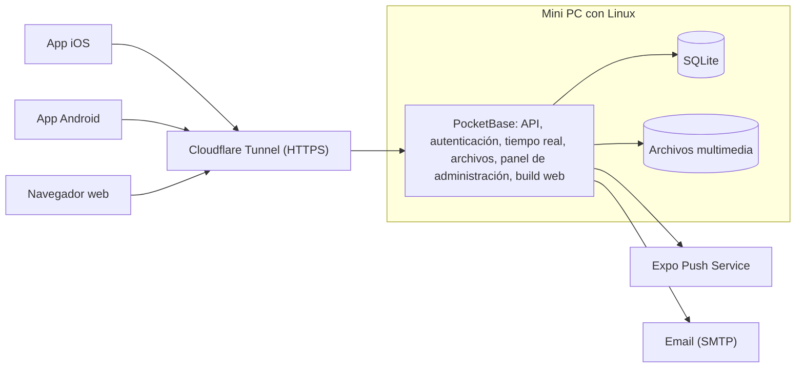

# Pawly

[English](README.md) · **Español**

Pawly es una red social para mascotas y animales. Funciona en Android e iOS, y también como app web. La gente presume a sus mascotas, da animales en adopción y les da seguimiento después de adoptados, y reporta animales callejeros, perdidos o encontrados para que la gente cercana pueda ayudar.

> **Lee esto antes de cada cambio.** Este README describe cómo funciona Pawly y en qué punto está el proyecto. Actualiza la sección [Estado del proyecto](#estado-del-proyecto) en el mismo pull request de cada cambio.

## Estado del proyecto

Etapa actual: **etapa 7.5, Diseño y detalles (en progreso).** Las etapas 8 y 9 se posponen hasta que esté lista la infraestructura (la mini PC). Última release: `v0.8.0` (etapa 7). El plan de todas las etapas está en el [plan de trabajo](docs/roadmap.es.md).

| # | Etapa | Estado |
| --- | --- | --- |
| – | Repositorio, CI, flujo de trabajo y alcance funcional | Hecho |
| 0 | Cimientos | Hecho |
| 1 | Cuentas | Hecho |
| 2 | Mascotas y publicaciones | Hecho |
| 3 | Interacción social | Hecho |
| 4 | Mensajes y notificaciones | Hecho |
| 5 | Adopción | Hecho |
| 6 | Rescate | Hecho |
| 7 | Moderación | Hecho |
| 7.5 | Diseño y detalles | En progreso |
| 8 | Infraestructura y web | Pospuesta |
| 9 | Lanzamiento | Pospuesta |
| 10 | Fase 2: veterinarias | Sin empezar |
| 11 | Fase 2: donaciones | Sin empezar |

Issues de la etapa 7.5: etapa 7.5 en el plan ([#83](https://github.com/AntOnionPro/pawly/issues/83), hecho), la barra superior tapa las listas ([#84](https://github.com/AntOnionPro/pawly/issues/84), hecho), espacio de más arriba del teclado ([#85](https://github.com/AntOnionPro/pawly/issues/85), hecho), logo, ícono y "Pawly" con la P ([#86](https://github.com/AntOnionPro/pawly/issues/86), hecho), letra Ubuntu ([#87](https://github.com/AntOnionPro/pawly/issues/87), hecho), paletas de color ([#88](https://github.com/AntOnionPro/pawly/issues/88), hecho), silueta del gato al iniciar sesión ([#89](https://github.com/AntOnionPro/pawly/issues/89)), texto arriba en las publicaciones ([#90](https://github.com/AntOnionPro/pawly/issues/90)), nueva pantalla para publicar y editar fotos y videos ([#91](https://github.com/AntOnionPro/pawly/issues/91)), animación de la huella ([#92](https://github.com/AntOnionPro/pawly/issues/92)), videos que se reproducen solos ([#93](https://github.com/AntOnionPro/pawly/issues/93)) y botones con Liquid Glass ([#94](https://github.com/AntOnionPro/pawly/issues/94)). Se publica como `v0.8.5`.

## Funcionalidades

### Fase 1 (MVP)

#### Cuentas

- Quien no tiene cuenta solo puede ver publicaciones. Cualquier interacción le pide registrarse.
- Registro e inicio de sesión con email y contraseña, Google o Apple.
- Cada usuario tiene un username público y único. Los nombres reales nunca se muestran.
- Verificación de email, recuperación y cambio de contraseña, cierre de sesión y edición del perfil (foto, username, bio).
- Eliminación de la cuenta desde la app y desde la web.
- Los usuarios aceptan los términos de servicio y el aviso de privacidad. Edad mínima: 13 años.

#### Perfiles de mascota

- Cada usuario registra a sus mascotas (nombre, especie, raza, edad, foto) y las etiqueta en sus publicaciones.
- Cuando una mascota se adopta, su perfil pasa al nuevo dueño.

#### Publicaciones y feed

- Publicaciones con texto, imágenes y videos, con varios archivos por publicación.
- Los usuarios reaccionan con una huella (la única reacción) y comentan. Pueden editar y borrar sus propias publicaciones y comentarios.
- Compartir hacia fuera de la app (menú de compartir del sistema con un enlace a la versión web) y dentro de la app (republicar o enviar por mensaje directo).
- Los usuarios se siguen entre sí. El inicio tiene dos pestañas: **Siguiendo** (publicaciones de quienes sigues) y **Descubrir** (todas las publicaciones). Sin cuenta solo se ve Descubrir. Las republicaciones aparecen en Siguiendo y en los perfiles, no en Descubrir.
- Búsqueda de usuarios (con sesión), mascotas (por nombre o raza) y publicaciones (por texto), desde el ícono en la parte superior de Inicio.

#### Mensajes directos

- Chat uno a uno entre usuarios en tiempo real, identificados solo por su username, desde el ícono en la parte superior de Inicio o el botón "Mensaje" de un perfil. Cualquiera con cuenta puede escribirle a cualquiera, salvo que haya un bloqueo.
- Bloquear y reportar desde la conversación.

#### Adopción

- La publicación de adopción incluye una ficha: especie, edad, sexo, tamaño, vacunas, esterilización, salud, ubicación aproximada y requisitos.
- Los interesados envían una solicitud. Quien publica la acepta o la rechaza y marca la mascota como adoptada.
- **Seguimiento:** el adoptante recibe recordatorios para subir fotos o videos a la semana, al mes, a los 3 meses y a los 6 meses. Quien la dio en adopción ve esas actualizaciones y puede reportar al adoptante si no las sube.

#### Rescate

Tres tipos de reporte, todos con fotos o videos, descripción y ubicación por GPS:

| Tipo | Descripción | Estados |
| --- | --- | --- |
| Necesita ayuda | Animal callejero herido, desnutrido, atrapado, etc., con nivel de urgencia. Otros usuarios pueden pulsar "Puedo ayudar". | Abierto → En atención → Resuelto |
| Perdido | Un dueño reporta a su mascota perdida (puede empezar desde el perfil de la mascota), con el lugar y la fecha en que se vio por última vez. | Perdido → Reunido |
| Encontrado | Alguien encontró un animal que parece tener dueño. | Encontrado → Reunido |

Los reportes se ven en una lista y en un mapa de casos cercanos. Los usuarios pueden activar avisos push de reportes cerca de ellos.

#### Moderación

- Reportar publicaciones, comentarios, mensajes, usuarios, fichas de adopción y reportes de rescate. Bloquear usuarios.
- Filtro de contenido y un panel de administración para revisar los reportes.

#### Notificaciones

- Push y dentro de la app para reacciones, comentarios, nuevos seguidores, mensajes, solicitudes de adopción, recordatorios de seguimiento de adopción y reportes de rescate cercanos (opcional).

#### Ajustes

- Idioma, tema, paleta de color, letra, preferencias de notificaciones, radio de cercanía, usuarios bloqueados, cambiar contraseña, eliminar cuenta, términos y aviso de privacidad, cerrar sesión.

### Fase 2

- **Veterinarias:** cuentas especiales con verificación (cédula profesional) y perfil de negocio (dirección, horarios, servicios). Pueden atender casos de rescate y promocionarse.
- **Donaciones** a quien publicó, sea una persona o una veterinaria. La App Store solo permite regalos de dinero entre personas fuera de su sistema de pagos cuando el 100 % llega a quien lo recibe, así que las donaciones a negocios hay que revisarlas antes. El proveedor de pagos para México está por definir (por ejemplo Mercado Pago o Stripe).

## Roles

| Rol | Puede |
| --- | --- |
| Visitante | Ver publicaciones, adopciones y reportes de rescate. |
| Usuario | Usar todas las funcionalidades de la fase 1. |
| Administrador | Revisar reportes, eliminar contenido y suspender usuarios desde el panel de PocketBase. |
| Veterinaria | Fase 2. |

## Diseño

- Estructura vertical tipo Instagram, con barra de navegación inferior.
- Pestañas: **Inicio · Adopción · Publicar (+) · Rescate · Perfil**. La búsqueda y las notificaciones van en la barra superior.
- Solo íconos en la interfaz, nunca emojis. Aspecto nativo en cada plataforma: SF Symbols en iOS y Material Symbols en Android.
- Logo: un gato que forma la letra P (`mobile/assets/brand/logo.svg`), en rosa `#FF2981`, que no cambia con la paleta elegida. El ícono de la app es el logo blanco sobre ese rosa (con versiones oscura y tintada en iOS y una monocromática en Android), e Inicio muestra "Pawly" escrito con esa P (`mobile/assets/brand/wordmark.svg`) en el color de acento.
- Letra: Ubuntu (ligera, normal, media y negrita), también en las barras de arriba y en la de pestañas. En ajustes se puede cambiar por la letra del celular (San Francisco en iOS, Roboto en Android). Lo que dibuja el sistema (avisos, teclado, menú de compartir) siempre usa la letra del sistema.
- La reacción es una huella, no un corazón.
- La versión web para computadora es la de menor prioridad.

### Colores

Tema claro: cada persona elige su paleta en ajustes (rosa por defecto). Cada paleta tiene un fondo muy claro (primario), un color muy oscuro para texto, íconos y barras (secundario) y un acento para la huella activa, el botón principal y la pestaña activa (terciario):

| Paleta | Primario (fondo) | Secundario (texto) | Terciario (acento) | Acento sobre fondo | Blanco sobre acento |
| --- | --- | --- | --- | --- | --- |
| Rosa (por defecto) | `#FFF5F7` | `#4A0818` | `#D84080` | 3.96:1 | 4.23:1 |
| Naranja | `#FFF7F0` | `#4A1C04` | `#D2560F` | 3.90:1 | 4.14:1 |
| Verde | `#F2FAF4` | `#0E3B1F` | `#2E8A4F` | 4.06:1 | 4.32:1 |
| Azul | `#F2F7FF` | `#0B2447` | `#2F6BD8` | 4.63:1 | 4.98:1 |
| Morado | `#F8F5FF` | `#2E1065` | `#7C3AED` | 5.29:1 | 5.70:1 |

El texto secundario, los bordes y el indicador de pestaña son mezclas de estos colores (`mobile/src/theme/colors.ts`). No hay amarillo: un acento amarillo vivo no se distingue sobre un fondo claro (2.1:1).

Tema oscuro:

| Color | Uso |
| --- | --- |
| `#000000` | Fondo |
| `#FFFFFF` | Texto, íconos y acentos |
| `#1C1C1E`, `#2C2C2E` | Superficies (tarjetas, barras) |
| `#3A3A3C` | Bordes y separadores |
| `#8E8E93` | Texto secundario |

Las paletas no se usan en el tema oscuro, que siempre es negro y blanco. El tema sigue la configuración del sistema y se puede cambiar en ajustes.

Contraste: todos los acentos dan al menos 3:1 sobre su fondo, suficiente para íconos y textos grandes o en negrita, pero no para texto pequeño (que necesita 4.5:1). El texto pequeño va en el color secundario (11.9:1 o más). `mobile/__tests__/contrast.test.ts` revisa todas las paletas.

### Idiomas

- Español e inglés. Por defecto se usa el idioma del teléfono; si no es ninguno de los dos, se usa inglés. Los usuarios pueden cambiarlo en ajustes.

## Arquitectura



| Parte | Tecnología | Por qué |
| --- | --- | --- |
| App (iOS, Android, web) | React Native con Expo, TypeScript, Expo Router | Un solo código que usa los componentes nativos de cada plataforma. |
| Backend | PocketBase (un solo ejecutable) | Gratis y alojado por nosotros: autenticación (email, Google, Apple), API REST, tiempo real, almacenamiento de archivos y panel de administración. |
| Base de datos | SQLite, integrada en PocketBase | Sin servicios externos ni costo. |
| Alojamiento | Mini PC con Linux en casa, expuesta con Cloudflare Tunnel | HTTPS sin abrir puertos del router. |
| Notificaciones push | Expo Push Service | Gratis. |
| Email | SMTP, proveedor por definir | Verificación y recuperación de contraseña. |
| Traducciones | expo-localization e i18next | Detecta el idioma del teléfono. |
| Compilación | EAS Build (plan gratuito) | Compila la app de iOS sin necesidad de una Mac. |

Notas:

- PocketBase también sirve el build web, así que un solo proceso sirve la API, la app web y el panel de administración.
- PocketBase aún no llega a la versión 1.0. Hay que fijar su versión y leer el changelog antes de actualizar.
- Los videos se comprimen en el dispositivo antes de subirlos.
- La base de datos SQLite y los archivos multimedia deben respaldarse fuera de la mini PC.

## Estructura del repositorio

Estructura planeada:

```text
pawly/
├── mobile/        App de Expo (iOS, Android y web)
├── server/        PocketBase: migraciones, hooks y configuración
├── docs/          Plan de trabajo y documentación adicional (aviso de privacidad, decisiones)
├── .github/       Plantillas de issues y PR, workflows y rulesets
├── CLAUDE.md      Contexto para Claude Code
├── CONTRIBUTING.md
└── LICENSE
```

Cómo correr cada parte:

- App: [mobile/README.es.md](mobile/README.es.md)
- Servidor: [server/README.es.md](server/README.es.md)

## Requisitos de publicación

App Store y Google Play:

- Eliminación de cuenta dentro de la app (ambas tiendas), además de una página web pública para solicitarla (Google Play).
- Inicio de sesión con Apple, porque se ofrece inicio de sesión con Google.
- Moderación del contenido de usuarios: reportar, bloquear, filtrar y un contacto publicado.
- URL pública de la política de privacidad, las etiquetas de privacidad de la App Store y el formulario de Seguridad de los datos de Google Play.
- Justificar cada permiso: cámara, fotos, ubicación y notificaciones.

México:

- Aviso de privacidad conforme a la Ley Federal de Protección de Datos Personales en Posesión de los Particulares (LFPDPPP).

Costos externos:

- Apple Developer Program: 99 USD al año.
- Google Play Console: 25 USD, pago único.
- Dominio: unos 10–15 USD al año (necesario para HTTPS, los enlaces para compartir y la página de privacidad).

## Pendientes

- Identificadores de la app para las tiendas (bundle ID de iOS y nombre de paquete de Android).
- Nombre de dominio.
- Texto en español de los permisos de fotos y de ubicación en iOS (la build usa inglés hasta la etapa 9).
- Proveedor de email (SMTP).
- Límites de video (tamaño y duración).
- Versiones mínimas soportadas de iOS y Android.

## Flujo de trabajo

Todo cambio sale de un issue, se trabaja en su propia rama desde `development` y llega a `development` por un pull request con el CI en verde. Las releases van de `development` a `main` por pull request. Detalles en [CONTRIBUTING.es.md](CONTRIBUTING.es.md).

## Licencia

Propietaria. Todos los derechos reservados. Ver [LICENSE](LICENSE).
