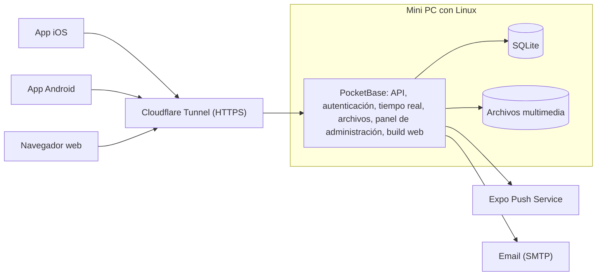

# Pawly

[English](README.md) · **Español**

Pawly es una red social para mascotas y animales. Funciona en Android e iOS, y también como app web. La gente presume a sus mascotas, da animales en adopción y les da seguimiento después de adoptados, y reporta animales callejeros, perdidos o encontrados para que la gente cercana pueda ayudar.

> **Lee esto antes de cada cambio.** Este README describe cómo funciona Pawly y en qué punto está el proyecto. Actualiza la sección [Estado del proyecto](#estado-del-proyecto) en el mismo pull request de cada cambio.

## Estado del proyecto

Etapa actual: **etapa 4, Mensajes y notificaciones (en progreso).** Última release: `v0.4.0` (etapa 3). El plan de todas las etapas está en el [plan de trabajo](docs/roadmap.es.md).

| # | Etapa | Estado |
| --- | --- | --- |
| – | Repositorio, CI, flujo de trabajo y alcance funcional | Hecho |
| 0 | Cimientos | Hecho |
| 1 | Cuentas | Hecho |
| 2 | Mascotas y publicaciones | Hecho |
| 3 | Interacción social | Hecho |
| 4 | Mensajes y notificaciones | En progreso |
| 5 | Adopción | Sin empezar |
| 6 | Rescate | Sin empezar |
| 7 | Moderación | Sin empezar |
| 8 | Infraestructura y web | Sin empezar |
| 9 | Lanzamiento | Sin empezar |
| 10 | Fase 2: veterinarias | Sin empezar |
| 11 | Fase 2: donaciones | Sin empezar |

Issues de la etapa 4: mensajes directos ([#43](https://github.com/AntOnionPro/pawly/issues/43), hecho), enviar publicaciones por mensaje ([#44](https://github.com/AntOnionPro/pawly/issues/44)), notificaciones dentro de la app ([#45](https://github.com/AntOnionPro/pawly/issues/45)), notificaciones push ([#46](https://github.com/AntOnionPro/pawly/issues/46)) y preferencias de notificaciones ([#47](https://github.com/AntOnionPro/pawly/issues/47)).

## Funcionalidades

### Fase 1 (MVP)

#### Cuentas

- Quien no tiene cuenta solo puede ver publicaciones. Cualquier interacción le pide registrarse.
- Registro e inicio de sesión con email y contraseña, Google o Apple.
- Cada usuario tiene un username público y único. Los nombres reales nunca se muestran.
- Verificación de email, recuperación y cambio de contraseña, cierre de sesión y edición del perfil (foto, username, bio).
- Eliminación de la cuenta desde la app y desde la web.
- Los usuarios aceptan los términos de servicio y el aviso de privacidad. Edad mínima: 13 años.

#### Perfiles de mascota

- Cada usuario registra a sus mascotas (nombre, especie, raza, edad, foto) y las etiqueta en sus publicaciones.
- Cuando una mascota se adopta, su perfil pasa al nuevo dueño.

#### Publicaciones y feed

- Publicaciones con texto, imágenes y videos, con varios archivos por publicación.
- Los usuarios reaccionan con una huella (la única reacción) y comentan. Pueden editar y borrar sus propias publicaciones y comentarios.
- Compartir hacia fuera de la app (menú de compartir del sistema con un enlace a la versión web) y dentro de la app (republicar o enviar por mensaje directo).
- Los usuarios se siguen entre sí. El inicio tiene dos pestañas: **Siguiendo** (publicaciones de quienes sigues) y **Descubrir** (todas las publicaciones). Sin cuenta solo se ve Descubrir. Las republicaciones aparecen en Siguiendo y en los perfiles, no en Descubrir.
- Búsqueda de usuarios (con sesión), mascotas (por nombre o raza) y publicaciones (por texto), desde el ícono en la parte superior de Inicio.

#### Mensajes directos

- Chat uno a uno entre usuarios en tiempo real, identificados solo por su username, desde el ícono en la parte superior de Inicio o el botón "Mensaje" de un perfil. Cualquiera con cuenta puede escribirle a cualquiera, salvo que haya un bloqueo.
- Bloquear y reportar desde la conversación.

#### Adopción

- La publicación de adopción incluye una ficha: especie, edad, sexo, tamaño, vacunas, esterilización, salud, ubicación aproximada y requisitos.
- Los interesados envían una solicitud. Quien publica la acepta o la rechaza y marca la mascota como adoptada.
- **Seguimiento:** el adoptante recibe recordatorios para subir fotos o videos a la semana, al mes, a los 3 meses y a los 6 meses. Quien la dio en adopción ve esas actualizaciones y puede reportar al adoptante si no las sube.

#### Rescate

Tres tipos de reporte, todos con fotos o videos, descripción y ubicación por GPS:

| Tipo | Descripción | Estados |
| --- | --- | --- |
| Necesita ayuda | Animal callejero herido, desnutrido, atrapado, etc., con nivel de urgencia. Otros usuarios pueden pulsar "Puedo ayudar". | Abierto → En atención → Resuelto |
| Perdido | Un dueño reporta a su mascota perdida (puede empezar desde el perfil de la mascota), con el lugar y la fecha en que se vio por última vez. | Perdido → Reunido |
| Encontrado | Alguien encontró un animal que parece tener dueño. | Encontrado → Reunido |

Los reportes se ven en una lista y en un mapa de casos cercanos. Los usuarios pueden activar avisos push de reportes cerca de ellos.

#### Moderación

- Reportar publicaciones, comentarios, mensajes y usuarios. Bloquear usuarios.
- Filtro de contenido y un panel de administración para revisar los reportes.

#### Notificaciones

- Push y dentro de la app para reacciones, comentarios, nuevos seguidores, mensajes, solicitudes de adopción, recordatorios de seguimiento de adopción y reportes de rescate cercanos (opcional).

#### Ajustes

- Idioma, tema, preferencias de notificaciones, radio de cercanía, usuarios bloqueados, cambiar contraseña, eliminar cuenta, términos y aviso de privacidad, cerrar sesión.

### Fase 2

- **Veterinarias:** cuentas especiales con verificación (cédula profesional) y perfil de negocio (dirección, horarios, servicios). Pueden atender casos de rescate y promocionarse.
- **Donaciones** a quien publicó, sea una persona o una veterinaria. La App Store solo permite regalos de dinero entre personas fuera de su sistema de pagos cuando el 100 % llega a quien lo recibe, así que las donaciones a negocios hay que revisarlas antes. El proveedor de pagos para México está por definir (por ejemplo Mercado Pago o Stripe).

## Roles

| Rol | Puede |
| --- | --- |
| Visitante | Ver publicaciones, adopciones y reportes de rescate. |
| Usuario | Usar todas las funcionalidades de la fase 1. |
| Administrador | Revisar reportes, eliminar contenido y suspender usuarios desde el panel de PocketBase. |
| Veterinaria | Fase 2. |

## Diseño

- Estructura vertical tipo Instagram, con barra de navegación inferior.
- Pestañas: **Inicio · Adopción · Publicar (+) · Rescate · Perfil**. La búsqueda y las notificaciones van en la barra superior.
- Solo íconos en la interfaz, nunca emojis. Aspecto nativo en cada plataforma: SF Symbols en iOS y Material Symbols en Android.
- La reacción es una huella, no un corazón.
- La versión web para computadora es la de menor prioridad.

### Colores

Tema claro:

| Rol | Color | Uso |
| --- | --- | --- |
| Primario | `#FFF5F7` (rosa pastel muy clarito) | Fondo |
| Secundario | `#4A0818` (vino oscuro) | Texto, íconos y barras |
| Terciario | `#D84080` (rosa) | Acentos: huella activa, botón principal, pestaña activa |

Tema oscuro:

| Color | Uso |
| --- | --- |
| `#000000` | Fondo |
| `#FFFFFF` | Texto, íconos y acentos |
| `#1C1C1E`, `#2C2C2E` | Superficies (tarjetas, barras) |
| `#3A3A3C` | Bordes y separadores |
| `#8E8E93` | Texto secundario |

El rosa y el vino no se usan en el tema oscuro. El tema sigue la configuración del sistema y se puede cambiar en ajustes.

Contraste: `#D84080` sobre `#FFF5F7` da 3.96:1, suficiente para íconos y textos grandes o en negrita, pero no para texto pequeño (que necesita 4.5:1). El texto pequeño va en `#4A0818` (14.7:1).

### Idiomas

- Español e inglés. Por defecto se usa el idioma del teléfono; si no es ninguno de los dos, se usa inglés. Los usuarios pueden cambiarlo en ajustes.

## Arquitectura



| Parte | Tecnología | Por qué |
| --- | --- | --- |
| App (iOS, Android, web) | React Native con Expo, TypeScript, Expo Router | Un solo código que usa los componentes nativos de cada plataforma. |
| Backend | PocketBase (un solo ejecutable) | Gratis y alojado por nosotros: autenticación (email, Google, Apple), API REST, tiempo real, almacenamiento de archivos y panel de administración. |
| Base de datos | SQLite, integrada en PocketBase | Sin servicios externos ni costo. |
| Alojamiento | Mini PC con Linux en casa, expuesta con Cloudflare Tunnel | HTTPS sin abrir puertos del router. |
| Notificaciones push | Expo Push Service | Gratis. |
| Email | SMTP, proveedor por definir | Verificación y recuperación de contraseña. |
| Traducciones | expo-localization e i18next | Detecta el idioma del teléfono. |
| Compilación | EAS Build (plan gratuito) | Compila la app de iOS sin necesidad de una Mac. |

Notas:

- PocketBase también sirve el build web, así que un solo proceso sirve la API, la app web y el panel de administración.
- PocketBase aún no llega a la versión 1.0. Hay que fijar su versión y leer el changelog antes de actualizar.
- Los videos se comprimen en el dispositivo antes de subirlos.
- La base de datos SQLite y los archivos multimedia deben respaldarse fuera de la mini PC.

## Estructura del repositorio

Estructura planeada:

```text
pawly/
├── mobile/        App de Expo (iOS, Android y web)
├── server/        PocketBase: migraciones, hooks y configuración
├── docs/          Plan de trabajo y documentación adicional (aviso de privacidad, decisiones)
├── .github/       Plantillas de issues y PR, workflows y rulesets
├── CLAUDE.md      Contexto para Claude Code
├── CONTRIBUTING.md
└── LICENSE
```

Cómo correr cada parte:

- App: [mobile/README.es.md](mobile/README.es.md)
- Servidor: [server/README.es.md](server/README.es.md)

## Requisitos de publicación

App Store y Google Play:

- Eliminación de cuenta dentro de la app (ambas tiendas), además de una página web pública para solicitarla (Google Play).
- Inicio de sesión con Apple, porque se ofrece inicio de sesión con Google.
- Moderación del contenido de usuarios: reportar, bloquear, filtrar y un contacto publicado.
- URL pública de la política de privacidad, las etiquetas de privacidad de la App Store y el formulario de Seguridad de los datos de Google Play.
- Justificar cada permiso: cámara, fotos, ubicación y notificaciones.

México:

- Aviso de privacidad conforme a la Ley Federal de Protección de Datos Personales en Posesión de los Particulares (LFPDPPP).

Costos externos:

- Apple Developer Program: 99 USD al año.
- Google Play Console: 25 USD, pago único.
- Dominio: unos 10–15 USD al año (necesario para HTTPS, los enlaces para compartir y la página de privacidad).

## Pendientes

- Logo e ícono de la app (la app usa los provisionales de Expo).
- Identificadores de la app para las tiendas (bundle ID de iOS y nombre de paquete de Android).
- Nombre de dominio.
- Texto en español del permiso de fotos en iOS (la build usa inglés hasta la etapa 9).
- Proveedor de mapas.
- Proveedor de email (SMTP).
- Límites de video (tamaño y duración).
- Versiones mínimas soportadas de iOS y Android.

## Flujo de trabajo

Todo cambio sale de un issue, se trabaja en su propia rama desde `development` y llega a `development` por un pull request con el CI en verde. Las releases van de `development` a `main` por pull request. Detalles en [CONTRIBUTING.es.md](CONTRIBUTING.es.md).

## Licencia

Propietaria. Todos los derechos reservados. Ver [LICENSE](LICENSE).
