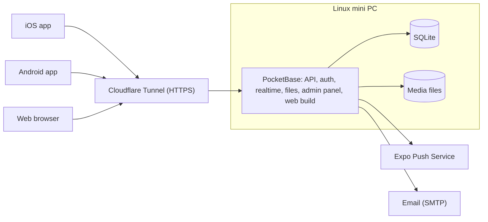

# Pawly

**English** · [Español](README.es.md)

Pawly is a social network for pets and animals. It runs on Android and iOS, and also as a web app. People show off their pets, put animals up for adoption and follow up on them after adoption, and report stray, lost or found animals so that people nearby can help.

> **Read this before every change.** This README describes how Pawly works and where the project stands. Update the [Project status](#project-status) section in the same pull request as each change.

## Project status

Current stage: **Stage 7.5, Design and details (done, pending the `v0.8.5` release to `main`).** Stages 8 and 9 are postponed until the infrastructure (the mini PC) is ready. Latest release: `v0.8.0` (stage 7). The plan for every stage is in the [roadmap](docs/roadmap.md).

| # | Stage | Status |
| --- | --- | --- |
| – | Repository, CI, workflow and functional scope | Done |
| 0 | Foundations | Done |
| 1 | Accounts | Done |
| 2 | Pets and posts | Done |
| 3 | Social interaction | Done |
| 4 | Messages and notifications | Done |
| 5 | Adoption | Done |
| 6 | Rescue | Done |
| 7 | Moderation | Done |
| 7.5 | Design and details | Done |
| 8 | Infrastructure and web | Postponed |
| 9 | Launch | Postponed |
| 10 | Phase 2: veterinary clinics | Not started |
| 11 | Phase 2: donations | Not started |

Stage 7.5 delivered: stage 7.5 in the roadmap ([#83](https://github.com/AntOnionPro/pawly/issues/83)), top bar covering lists ([#84](https://github.com/AntOnionPro/pawly/issues/84)), extra space above the keyboard ([#85](https://github.com/AntOnionPro/pawly/issues/85)), logo, app icon and wordmark ([#86](https://github.com/AntOnionPro/pawly/issues/86)), Ubuntu font ([#87](https://github.com/AntOnionPro/pawly/issues/87)), color palettes ([#88](https://github.com/AntOnionPro/pawly/issues/88)), cat silhouette on sign-in ([#89](https://github.com/AntOnionPro/pawly/issues/89)), text first in posts ([#90](https://github.com/AntOnionPro/pawly/issues/90)), new post screen and editing media ([#91](https://github.com/AntOnionPro/pawly/issues/91)), paw print animation ([#92](https://github.com/AntOnionPro/pawly/issues/92)), autoplaying videos ([#93](https://github.com/AntOnionPro/pawly/issues/93)), Liquid Glass buttons ([#94](https://github.com/AntOnionPro/pawly/issues/94)), the previous account's paw prints showing after switching accounts ([#107](https://github.com/AntOnionPro/pawly/issues/107)), Adoption as a list with search and compact filters ([#108](https://github.com/AntOnionPro/pawly/issues/108)), the app name and watercolor cats on sign-in ([#109](https://github.com/AntOnionPro/pawly/issues/109)) and the sign-in cat needing a scroll to be seen whole ([#113](https://github.com/AntOnionPro/pawly/issues/113)). It is released as `v0.8.5`.

## Features

### Phase 1 (MVP)

#### Accounts

- Visitors without an account can only view posts. Any interaction asks them to sign up.
- Sign up and sign in with email and password, Google or Apple.
- Every user has a unique public username. Real names are never shown.
- Email verification, password recovery and change, sign out, and profile editing (photo, username, bio).
- Account deletion from the app and from the web.
- Users accept the terms of service and the privacy notice. Minimum age: 13.

#### Pet profiles

- Each user registers their pets (name, species, breed, age, photo) and tags them in posts.
- When a pet is adopted, its profile moves to the new owner.

#### Posts and feed

- Posts with text, images and videos, with several files per post. A post reads from top to bottom: author, text, tagged pets, photos and videos, and the counts of paw prints, comments and reposts. In the feed, long texts are cut to three lines with "See more". Writing a post follows the same order: who posts (with "Publish" at the top), the text, the photos and videos (with "+" to add more) and the tagged pets.
- Videos play on their own, muted and in a loop, when they are in view in Home (one at a time) and on the post page, and pause when they leave the screen. A tap turns the sound on or off (and the next videos keep that choice), and a button opens them in fullscreen. Vertical videos show taller, up to 4:5. In settings, "Autoplay videos" can be "Always", "Wi-Fi only" or "Never"; with the phone's "Reduce motion" setting (or the browser's data saver) they never start on their own, and a play button starts them.
- Users react with a paw print (the only reaction) and comment. Giving a paw print makes it bounce with a light vibration, and a double tap on a photo or video also gives it (never takes it back), with a big paw print that fades away. With the phone's "Reduce motion" setting there is no animation. They can edit and delete their own posts and comments; editing a post also removes and adds photos and videos.
- Sharing outside the app (system share sheet with a link to the web version) and inside the app (repost, or send by direct message).
- Users follow each other. Home has two tabs: **Following** (posts by the people you follow) and **Discover** (every post). Visitors only see Discover. Reposts appear in Following and on profiles, not in Discover.
- Search for users (with a session), pets (by name or breed) and posts (by text), from the icon at the top of Home.

#### Direct messages

- One-to-one chat between users in real time, identified only by username, from the icon at the top of Home or the "Message" button of a profile. Anyone with an account can write to anyone, except across a block.
- Block and report from the conversation.

#### Adoption

- An adoption post includes a profile: species, age, sex, size, vaccines, spay/neuter, health, approximate location and requirements.
- The Adoption tab lists the pets up for adoption, with a search box (name, breed, description or area) and filters by species, size, sex and publication date (today, last 7 days or last 30 days), each in one line that scrolls sideways.
- Interested users send a request. The publisher accepts or rejects it and marks the pet as adopted.
- **Follow-up:** the adopter gets reminders to post photos or videos after 1 week, 1 month, 3 months and 6 months. The previous owner sees these updates and can report the adopter if they are not posted.

#### Rescue

Three kinds of report, each with photos or videos, a description and a GPS location:

| Kind | Description | Statuses |
| --- | --- | --- |
| Needs help | A stray animal that is injured, malnourished, trapped, etc., with an urgency level. Other users can press "I can help". | Open → In progress → Resolved |
| Lost | An owner reports a missing pet (it can start from the pet's profile), with the place and date it was last seen. | Lost → Reunited |
| Found | Someone found an animal that seems to have an owner. | Found → Reunited |

Reports appear as a list and on a map of nearby cases, with a search box (description, place or pet's name) and filters by kind and date. Users can opt in to push alerts for reports near them.

#### Moderation

- Report posts, comments, messages, users, adoption listings and rescue reports. Block users.
- Content filter, and an admin panel to review reports.

#### Notifications

- Push and in-app notifications for reactions, comments, new followers, messages, adoption requests, adoption follow-up reminders, and nearby rescue reports (opt-in).

#### Settings

- Language, theme, color palette, font, autoplay videos, notification preferences, nearby radius, blocked users, change password, delete account, terms and privacy notice, sign out.

### Phase 2

- **Veterinary clinics:** special accounts with verification (professional license) and a business profile (address, hours, services). Clinics can take on rescue cases and promote themselves.
- **Donations** to whoever published a post, whether a person or a clinic. The App Store only allows person-to-person gifts outside in-app purchase when 100% reaches the recipient, so donations to businesses need review first. The payment provider for Mexico is still open (for example Mercado Pago or Stripe).

## Roles

| Role | Can |
| --- | --- |
| Visitor | View posts, adoptions and rescue reports. |
| User | Use every Phase 1 feature. |
| Admin | Review reports, remove content and suspend users from the PocketBase admin panel. |
| Veterinary clinic | Phase 2. |

## Design

- Vertical layout like Instagram, with a bottom navigation bar.
- Tabs: **Home · Adoption · Post (+) · Rescue · Profile**. Search and notifications live in the top bar.
- Icons only, never emojis, in the interface. Native look on each platform: SF Symbols on iOS and Material Symbols on Android.
- Logo: a cat that forms the letter P (`mobile/assets/brand/logo.svg`), in pink `#FF2981`, which stays the same whatever palette is chosen. The app icon is the white logo on that pink (with dark and tinted versions on iOS and a monochrome one on Android), and Home shows "Pawly" written with that P (`mobile/assets/brand/wordmark.svg`) in the accent color. Sign-in and sign-up show "Pawly" with that P above the fields and, at the bottom, one of three watercolor cats (black, Siamese and ginger, in `mobile/assets/images/cats/`) chosen at random each time; in the dark theme only the Siamese and the ginger one, since the black one would not show. The cat never sits under text; on sign-in it fits in the room left under the fields, so nothing needs scrolling (with too little room, for example with the keyboard open, it does not show).
- Font: Ubuntu (light, regular, medium and bold), also in the top bars and the tab bar. In settings it can be changed to the phone's own font (San Francisco on iOS, Roboto on Android). What the system draws (alerts, keyboard, share sheet) always uses the system font.
- The reaction is a paw print, not a heart.
- Buttons: a form's main action ("Save", "Publish") is in the top bar, on the right: Liquid Glass tinted with the accent on iOS 26, bold text on earlier iOS, a Material 3 text button on Android and a compact button on the web. The main action of Adoption and Rescue ("Put up for adoption", "Report a case") floats at the bottom right: Liquid Glass on iOS 26, a Material 3 extended FAB on Android and a pill with a shadow elsewhere. Other actions in details and profiles are compact buttons side by side. The Post tab has no top bar, so "Publish" is a glass button at the top of the screen. Every button keeps its accessible name and a touch area of at least 44 points.
- The desktop web version has the lowest priority.

### Colors

Light theme: each person chooses its palette in settings (pink by default). Every palette has a very light background (primary), a very dark color for text, icons and bars (secondary) and an accent for the active paw print, the main button and the active tab (tertiary):

| Palette | Primary (background) | Secondary (text) | Tertiary (accent) | Accent on background | White on accent |
| --- | --- | --- | --- | --- | --- |
| Pink (default) | `#FFF5F7` | `#4A0818` | `#D84080` | 3.96:1 | 4.23:1 |
| Orange | `#FFF7F0` | `#4A1C04` | `#D2560F` | 3.90:1 | 4.14:1 |
| Green | `#F2FAF4` | `#0E3B1F` | `#2E8A4F` | 4.06:1 | 4.32:1 |
| Blue | `#F2F7FF` | `#0B2447` | `#2F6BD8` | 4.63:1 | 4.98:1 |
| Purple | `#F8F5FF` | `#2E1065` | `#7C3AED` | 5.29:1 | 5.70:1 |

Secondary text, borders and the tab indicator are blends of these colors (`mobile/src/theme/colors.ts`). There is no yellow: a bright yellow accent is not visible on a light background (2.1:1).

Dark theme:

| Color | Use |
| --- | --- |
| `#000000` | Background |
| `#FFFFFF` | Text, icons and accents |
| `#1C1C1E`, `#2C2C2E` | Surfaces (cards, bars) |
| `#3A3A3C` | Borders and dividers |
| `#8E8E93` | Secondary text |

The palettes are not used in the dark theme, which is always black and white. The theme follows the system setting and can be changed in settings.

Contrast: every accent is at least 3:1 on its background, enough for icons and large or bold text but not for small text (which needs 4.5:1). Small text uses the secondary color (11.9:1 or more). `mobile/__tests__/contrast.test.ts` checks every palette.

### Languages

- Spanish and English. The default follows the phone's language, falling back to English when it is neither. Users can change it in settings.

## Architecture



| Part | Technology | Why |
| --- | --- | --- |
| App (iOS, Android, web) | React Native with Expo, TypeScript, Expo Router | One codebase that uses each platform's native components. |
| Backend | PocketBase (single binary) | Free and self-hosted: auth (email, Google, Apple), REST API, realtime, file storage and admin panel. |
| Database | SQLite, embedded in PocketBase | No external service and no cost. |
| Hosting | Linux mini PC at home, exposed through Cloudflare Tunnel | HTTPS without opening router ports. |
| Push notifications | Expo Push Service | Free. |
| Email | SMTP, provider to be decided | Verification and password reset. |
| Translations | expo-localization and i18next | Detects the phone's language. |
| Builds | EAS Build (free tier) | Builds the iOS app without a Mac. |

Notes:

- PocketBase also serves the web build, so a single process serves the API, the web app and the admin panel.
- PocketBase is still before version 1.0. Pin its version and read the changelog before upgrading.
- Videos are compressed on the device before upload.
- The SQLite database and the media files must be backed up outside the mini PC.

## Repository structure

Planned layout:

```text
pawly/
├── mobile/        Expo app (iOS, Android and web)
├── server/        PocketBase: migrations, hooks and configuration
├── docs/          Roadmap and additional documentation (privacy notice, decisions)
├── .github/       Issue and PR templates, workflows and rulesets
├── CLAUDE.md      Context for Claude Code
├── CONTRIBUTING.md
└── LICENSE
```

How to run each part:

- App: [mobile/README.md](mobile/README.md)
- Server: [server/README.md](server/README.md)

## Publishing requirements

App Store and Google Play:

- In-app account deletion (both stores), plus a public web page to request it (Google Play).
- Sign in with Apple, because Google sign-in is offered.
- Moderation of user content: reporting, blocking, filtering and a published contact.
- A public privacy policy URL, the App Store privacy labels and the Google Play Data safety form.
- A stated reason for each permission: camera, photos, location and notifications.

Mexico:

- Privacy notice (*aviso de privacidad*) under the Federal Law on Protection of Personal Data Held by Private Parties (LFPDPPP).

External costs:

- Apple Developer Program: USD 99 per year.
- Google Play Console: USD 25, one-time.
- Domain: about USD 10–15 per year (needed for HTTPS, share links and the privacy page).

## Open items

- App identifiers for the stores (iOS bundle ID and Android package name).
- Domain name.
- Spanish text for the iOS photo library and location permissions (the build uses English until stage 9).
- Email (SMTP) provider.
- Video limits (size and duration).
- Minimum supported iOS and Android versions.

## Workflow

Every change starts from an issue, goes in its own branch from `development`, and reaches `development` through a pull request with CI in green. Releases go from `development` to `main` through a pull request. Details in [CONTRIBUTING.md](CONTRIBUTING.md).

## License

Proprietary. All rights reserved. See [LICENSE](LICENSE).
