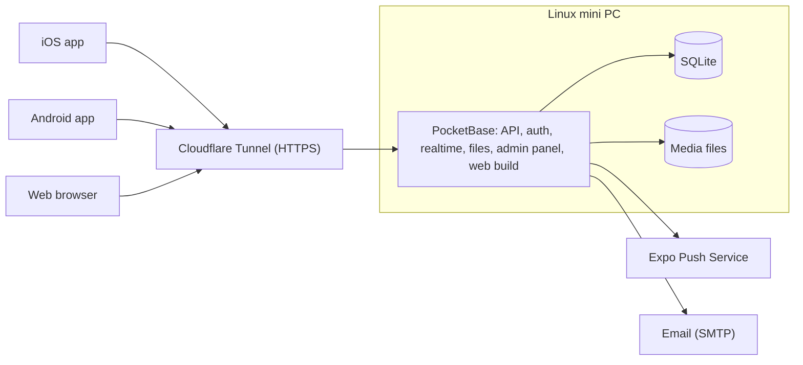

# Pawly

**English** · [Español](README.es.md)

Pawly is a social network for pets and animals. It runs on Android and iOS, and also as a web app. People show off their pets, put animals up for adoption and follow up on them after adoption, and report stray, lost or found animals so that people nearby can help.

> **Read this before every change.** This README describes how Pawly works and where the project stands. Update the [Project status](#project-status) section in the same pull request as each change.

## Project status

Current stage: **scope agreed, no application code yet.**

| Area | Status |
| --- | --- |
| Repository, CI and workflow | Done |
| Functional scope (this README) | Agreed |
| App scaffold (Expo) | Not started |
| Backend (PocketBase) | Not started |
| Accounts | Not started |
| Pet profiles | Not started |
| Posts and feed | Not started |
| Direct messages | Not started |
| Adoption | Not started |
| Rescue (needs help, lost, found) | Not started |
| Moderation | Not started |
| Notifications | Not started |
| Settings and languages | Not started |
| Web version | Not started |
| Store publishing | Not started |
| Phase 2: veterinary clinics and donations | Not started |

Next step: scaffold the Expo app and the PocketBase server.

## Features

### Phase 1 (MVP)

#### Accounts

- Visitors without an account can only view posts. Any interaction asks them to sign up.
- Sign up and sign in with email and password, Google or Apple.
- Every user has a unique public username. Real names are never shown.
- Email verification, password recovery and change, sign out, and profile editing (photo, username, bio).
- Account deletion from the app and from the web.
- Users accept the terms of service and the privacy notice. Minimum age: 13.

#### Pet profiles

- Each user registers their pets (name, species, breed, age, photo) and tags them in posts.
- When a pet is adopted, its profile moves to the new owner.

#### Posts and feed

- Posts with text, images and videos, with several files per post.
- Users react with a paw print (the only reaction) and comment. They can edit and delete their own posts and comments.
- Sharing outside the app (system share sheet with a link to the web version) and inside the app (repost, or send by direct message).
- Users follow each other. The home feed mixes people you follow with content to discover.
- Search for users, pets and posts.

#### Direct messages

- One-to-one chat between users, identified only by username.
- Block and report from the conversation.

#### Adoption

- An adoption post includes a profile: species, age, sex, size, vaccines, spay/neuter, health, approximate location and requirements.
- Interested users send a request. The publisher accepts or rejects it and marks the pet as adopted.
- **Follow-up:** the adopter gets reminders to post photos or videos after 1 week, 1 month, 3 months and 6 months. The previous owner sees these updates and can report the adopter if they are not posted.

#### Rescue

Three kinds of report, each with photos or videos, a description and a GPS location:

| Kind | Description | Statuses |
| --- | --- | --- |
| Needs help | A stray animal that is injured, malnourished, trapped, etc., with an urgency level. Other users can press "I can help". | Open → In progress → Resolved |
| Lost | An owner reports a missing pet (it can start from the pet's profile), with the place and date it was last seen. | Lost → Reunited |
| Found | Someone found an animal that seems to have an owner. | Found → Reunited |

Reports appear as a list and on a map of nearby cases. Users can opt in to push alerts for reports near them.

#### Moderation

- Report posts, comments, messages and users. Block users.
- Content filter, and an admin panel to review reports.

#### Notifications

- Push and in-app notifications for reactions, comments, new followers, messages, adoption requests, adoption follow-up reminders, and nearby rescue reports (opt-in).

#### Settings

- Language, theme, notification preferences, nearby radius, blocked users, change password, delete account, terms and privacy notice, sign out.

### Phase 2

- **Veterinary clinics:** special accounts with verification (professional license) and a business profile (address, hours, services). Clinics can take on rescue cases and promote themselves.
- **Donations** to whoever published a post, whether a person or a clinic. The App Store only allows person-to-person gifts outside in-app purchase when 100% reaches the recipient, so donations to businesses need review first. The payment provider for Mexico is still open (for example Mercado Pago or Stripe).

## Roles

| Role | Can |
| --- | --- |
| Visitor | View posts, adoptions and rescue reports. |
| User | Use every Phase 1 feature. |
| Admin | Review reports, remove content and suspend users from the PocketBase admin panel. |
| Veterinary clinic | Phase 2. |

## Design

- Vertical layout like Instagram, with a bottom navigation bar.
- Tabs: **Home · Adoption · Post (+) · Rescue · Profile**. Search and notifications live in the top bar.
- Icons only, never emojis, in the interface. Native look on each platform: SF Symbols on iOS and Material Symbols on Android.
- The reaction is a paw print, not a heart.
- The desktop web version has the lowest priority.

### Colors

| Role | Light theme | Dark theme |
| --- | --- | --- |
| Primary | Very light pastel pink | White |
| Secondary | Dark wine | Gray scale |
| Tertiary | White or black | Black (background) |

The dark theme uses a black background, gray scale, and white text and details. Pink and wine are not used in it. The theme follows the system setting and can be changed in settings.

### Languages

- Spanish and English. The default follows the phone's language, falling back to English when it is neither. Users can change it in settings.

## Architecture



| Part | Technology | Why |
| --- | --- | --- |
| App (iOS, Android, web) | React Native with Expo, TypeScript, Expo Router | One codebase that uses each platform's native components. |
| Backend | PocketBase (single binary) | Free and self-hosted: auth (email, Google, Apple), REST API, realtime, file storage and admin panel. |
| Database | SQLite, embedded in PocketBase | No external service and no cost. |
| Hosting | Linux mini PC at home, exposed through Cloudflare Tunnel | HTTPS without opening router ports. |
| Push notifications | Expo Push Service | Free. |
| Email | SMTP, provider to be decided | Verification and password reset. |
| Translations | expo-localization and i18next | Detects the phone's language. |
| Builds | EAS Build (free tier) | Builds the iOS app without a Mac. |

Notes:

- PocketBase also serves the web build, so a single process serves the API, the web app and the admin panel.
- PocketBase is still before version 1.0. Pin its version and read the changelog before upgrading.
- Videos are compressed on the device before upload.
- The SQLite database and the media files must be backed up outside the mini PC.

## Repository structure

Planned layout:

```text
pawly/
├── mobile/        Expo app (iOS, Android and web)
├── server/        PocketBase: migrations, hooks and configuration
├── docs/          Additional documentation (privacy notice, decisions)
├── .github/       Issue and PR templates, workflows and rulesets
├── CLAUDE.md      Context for Claude Code
├── CONTRIBUTING.md
└── LICENSE
```

## Publishing requirements

App Store and Google Play:

- In-app account deletion (both stores), plus a public web page to request it (Google Play).
- Sign in with Apple, because Google sign-in is offered.
- Moderation of user content: reporting, blocking, filtering and a published contact.
- A public privacy policy URL, the App Store privacy labels and the Google Play Data safety form.
- A stated reason for each permission: camera, photos, location and notifications.

Mexico:

- Privacy notice (*aviso de privacidad*) under the Federal Law on Protection of Personal Data Held by Private Parties (LFPDPPP).

External costs:

- Apple Developer Program: USD 99 per year.
- Google Play Console: USD 25, one-time.
- Domain: about USD 10–15 per year (needed for HTTPS, share links and the privacy page).

## Open items

- Exact color values (hex).
- Domain name.
- Map provider.
- Email (SMTP) provider.
- Video limits (size and duration).
- Minimum supported iOS and Android versions.

## Workflow

Every change starts from an issue, goes in its own branch from `development`, and reaches `development` through a pull request with CI in green. Releases go from `development` to `main` through a pull request. Details in [CONTRIBUTING.md](CONTRIBUTING.md).

## License

Proprietary. All rights reserved. See [LICENSE](LICENSE).
